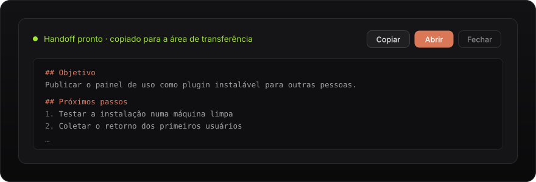
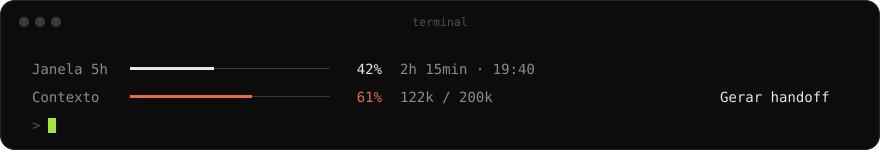

<div align="center">

# usage-hud

### Veja o que o Claude está fazendo, quanto ainda cabe na sessão, e leve tudo para uma sessão nova em um clique.

<p>
  
  
  
  
</p>



<br>

**👑 Rei Clawd · ⏱️ Janela de 5h · 🧠 Contexto · 📋 Handoff**

</div>

<br>

## Por que usar

Numa tarefa longa, três coisas costumam pegar você de surpresa: o contexto acaba, o limite de uso chega, ou você não sabe se o Claude está trabalhando, pensando ou parado esperando você.

O **usage-hud** fica logo acima de onde você digita e resolve as três:

- O **Rei Clawd** mostra, pela pose, o que o Claude está fazendo agora.
- As **barras** mostram quanto da janela de 5 horas e do contexto já foi usado, e esquentam até o vermelho quando está acabando.
- O **handoff** salva um resumo da sessão em arquivo e abre uma sessão nova já pronta para continuar.

<br>

## 👑 Rei Clawd

Um rei em pixel art fica à esquerda do HUD. A pose dele não é decoração: cada uma vem de um evento real da sessão, então ela mostra o que o agente está fazendo de fato.

<div align="center">
  
</div>

| Pose | O que o Claude está fazendo | Evento |
|---|---|---|
| Parado | Nada, esperando você escrever | `session.start`, ou fim do turno sem nada rodando |
| Pensando | Gerando a resposta | `turn.start`, `turn.step` |
| Lendo | Lendo ou procurando arquivos | `tool.call`: Read, Grep, Glob |
| Editando | Mexendo em código ou arquivos | `tool.call`: Edit, Write, NotebookEdit |
| No terminal | Rodando comandos | `tool.call`: Bash, PowerShell |
| Na web | Pesquisando ou abrindo páginas | `tool.call`: WebSearch, WebFetch, navegador |
| Orquestrando | Lançou subagents e coordena dentro da resposta | `tool.call`: Agent |
| Trabalhando | Usando qualquer outra ferramenta (MCP, skills…) | `tool.call` |
| Esperando você | Fez uma pergunta ou mostrou um plano | `tool.call`: AskUserQuestion, ExitPlanMode |
| Aguardando | Já respondeu, mas há tarefas rodando em segundo plano | `turn.complete` com agentes ainda `running` |
| Compactando | Resumindo a conversa | `session.compact` |
| Concluído | Terminou a resposta | `turn.complete`, `reason: 'answer'` |
| Interrompido | Você apertou Esc | `turn.complete`, `reason: 'aborted'` |
| Erro | Erro da API ou recusa | `turn.complete`, `reason: 'error'` ou `'refusal'` |

Concluído, Interrompido e Erro duram 5 segundos e depois ele volta para Parado, ou para Aguardando se ainda houver algo rodando. Só a sessão principal muda a pose: o que os subagents fazem por dentro não interfere.

O desenho do rei veio do mod [tripulação](https://github.com/ba-lison/tripulacao), mas o usage-hud não depende dele: o pixel art está copiado em `hooks/clawd.ts`.

<br>

## ⏱️ Janela de 5h e 🧠 Contexto

<div align="center">
  
</div>

- **Janela 5h**, no laranja do Claude: quanto do limite de 5 horas já foi usado, a hora em que ele renova e quanto tempo falta.
- **Contexto**, em azul: quanto da memória da sessão está ocupado, em porcentagem e em tokens, e quanto ainda cabe.

As duas barras mantêm a própria cor até **75%** e só então esquentam até o vermelho em **100%**. Assim você distingue uma da outra pela cor, e o vermelho só aparece quando importa. Um **mini Clawd** anda na ponta de cada barra, com a cor daquele ponto.

<br>

## 📋 Handoff

<div align="center">
  
</div>

O botão **Gerar handoff** escreve um resumo da sessão para você continuar numa conversa nova sem perder nada. O formato é enxuto (cerca de 600 tokens), inspirado em micro-handoffs:

- **Objetivo** e **estado**, com a branch e o último commit
- Até 5 **decisões**, com o motivo e o que foi descartado
- Até 10 **arquivos**, cada um com uma linha
- **Bloqueios e pendências**, **preferências** e o **próximo passo**

Quando fica pronto:

1. O handoff é **salvo em `.claude/handoff/latest.md`**, com uma cópia datada ao lado. Nada se perde se a cópia para a área de transferência falhar.
2. Ele é **copiado** já com a instrução de leitura na frente, então colar basta.
3. O HUD mostra **quanto custou**, quanto veio do cache e avisa se o cache estava frio.
4. **Continuar em sessão nova** limpa a conversa (`/clear`) e deixa no campo o pedido para ler o handoff. A sessão nova começa pequena, sem colar o texto inteiro.

Numa sessão nova, se existe um handoff das últimas 24 horas, o HUD oferece **Retomar**.

Acima de 73% de contexto aparece também o botão **Compactar**. Ele resume a sessão no mesmo formato sem sair dela, usando a compactação nativa do Claude Code.

> [!TIP]
> O handoff sai mais barato com o cache quente. Gere logo depois de uma resposta, e não depois de muito tempo parado ou de trocar de modelo: nesses casos o Claude paga a conversa inteira de novo.

O handoff também foi feito para não travar:

- Se algo der errado, ou se demorar mais de 3 minutos, o botão volta sozinho e diz o motivo.
- Clicar duas vezes não gera dois handoffs.
- Se o contexto passou de 97% e o handoff não cabe mais, o HUD indica **Compactar** no lugar.

<br>

## 💻 Funciona no app e no terminal

No **app desktop** (aba Code), o HUD é um cartão com o Rei Clawd animado e as barras. No **terminal**, ele vira texto: o status do rei numa linha e as duas barras abaixo, com os mesmos botões.

<div align="center">
  
</div>

<br>

## Instalação

Abra o Claude Code **no terminal** (`claude`) e digite:

```
/plugin install usage-hud --marketplace ba-lison/usage-hud
```

1. Responda **`y`** para adicionar o marketplace.
2. Dê **Enter** no escopo **user**, para valer em todas as sessões.
3. **Abra uma sessão nova.** Um mod instalado no meio da sessão só aparece na próxima.

> [!NOTE]
> O comando `/plugin install` só funciona no terminal. Na aba Code do app ele não está disponível, mas o HUD instalado pelo terminal aparece lá normalmente.

<br>

## Atualizar

```
/plugin marketplace update balison-mods
```

Depois, abra uma sessão nova.

<br>

## Perguntas frequentes

<details>
<summary><b>Por que a Janela 5h mostra "aguardando a primeira resposta"?</b></summary>
<br>
O uso da janela só é informado depois que o Claude responde pela primeira vez na sessão. Mande qualquer mensagem e o número aparece.
</details>

<details>
<summary><b>Devo commitar a pasta <code>.claude/handoff/</code>?</b></summary>
<br>
Não precisa. Ela guarda os handoffs da sua máquina. Se preferir mantê-la fora do git, adicione <code>.claude/handoff/</code> ao <code>.gitignore</code> do projeto.
</details>

<details>
<summary><b>O "Continuar em sessão nova" não limpou a conversa.</b></summary>
<br>
Se o Claude Code não deixar o mod rodar o <code>/clear</code>, o HUD avisa e deixa o pedido no campo de mensagem. Rode <code>/clear</code> e envie o texto que ficou lá.
</details>

<details>
<summary><b>O handoff pode ser em outro idioma ou ter outras seções?</b></summary>
<br>
Sim. O pedido fica em <code>HANDOFF_PROMPT</code>, no arquivo <code>hooks/register.tsx</code>. Troque o texto pelo idioma e pelas seções que preferir.
</details>

<details>
<summary><b>O Rei Clawd atrapalha o Claude?</b></summary>
<br>
Não. Ele só observa os eventos da sessão e nunca bloqueia uma ferramenta ou um turno: se algo falhar no desenho dele, o Claude segue normalmente. O HUD inteiro também sai da frente quando o Claude Code precisa do espaço, como numa pesquisa de satisfação.
</details>

<br>

## Para desenvolver

| Arquivo | O que tem |
|---|---|
| `hooks/register.tsx` | Os hooks: barras, estado do Rei Clawd e handoff |
| `hooks/clawd.ts` | O pixel art do rei, as 14 poses, o mini Clawd e as cores das barras |
| `types/index.d.ts` | O contrato do estado que o HUD guarda na sessão |
| `tests/band.test.ts` | Testes do HUD, das poses e das cores |
| `docs/gerar-imagens.mjs` | Gera as imagens deste README a partir de `hooks/clawd.ts` |
| `docs/prototipo/` | O protótipo visual, as decisões de design e o diagnóstico do handoff |

### ✅ Checklist: editar, testar e publicar

Toda mudança é testada localmente antes de ir para o GitHub.

1. Edite os arquivos nesta pasta.
2. Valide e teste:

   ```bash
   claude plugin validate .
   ```

   ```bash
   claude plugin test .
   ```

3. Se mudou o visual, gere as imagens do README de novo:

   ```bash
   node docs/gerar-imagens.mjs
   ```

4. Instale a partir desta pasta para testar de verdade:

   ```bash
   claude plugin marketplace remove balison-mods
   ```

   ```bash
   claude plugin install usage-hud --marketplace "E:\Users\aliso\Documents\.Projetos\usage-hud" -y
   ```

   Abra uma sessão nova e confira.

5. Funcionou? Suba `version` em `.claude-plugin/plugin.json` (só quando o código muda), faça o commit e o `git push`.
6. Volte a instalar pelo GitHub:

   ```bash
   claude plugin marketplace remove balison-mods
   ```

   ```bash
   claude plugin install usage-hud --marketplace ba-lison/usage-hud -y
   ```

7. Confira com `git status` que não sobrou nada fora do commit e que a branch está igual à `origin/main`.

Não copie esta pasta para `~/.claude/skills` nem crie atalho ou junction: o mod carregaria duas vezes ou falharia com "Path escapes plugin directory".

<br>

## Licença

[MIT](LICENSE) © Alison Cruz

<br>

<div align="center">
<sub>Feito por <a href="https://github.com/ba-lison">Alison Cruz</a></sub>
</div>
